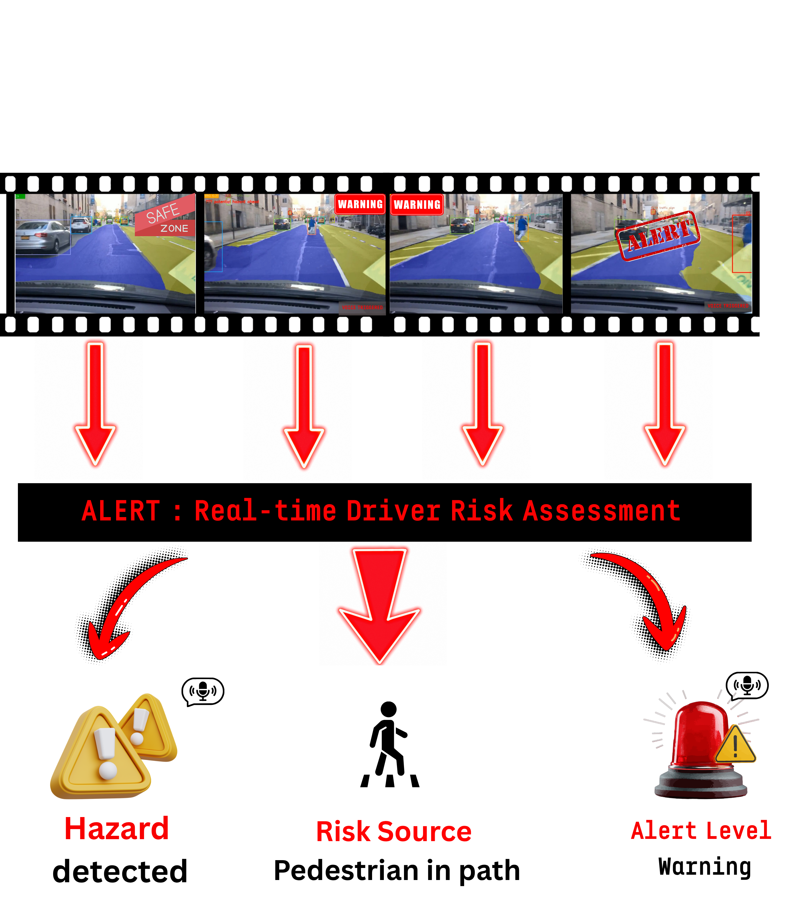

<div align="center">

# ALERT

**Area parsing, Localization, Estimation of Risk, and Tracking**

*A modular dashcam perception pipeline that turns raw driving footage into risk-aware driver alerts.*

<p>
  
  
  
  
</p>



</div>

---

## Overview

ALERT takes monocular dashcam video and answers one question per frame: **which road users are dangerous right now, and how dangerous?**

It chains four stages into a single configurable pipeline:

1. **Object detection** finds vehicles, pedestrians, riders and other road users.
2. **Drivable-area segmentation** parses the road surface ahead of the ego vehicle.
3. **Multi-object tracking** assigns persistent identities across frames.
4. **Risk reasoning** fuses everything into per-object scores and scene-level alerts.

For each tracked object, the risk module combines an **in-path likelihood** (overlap with the drivable area), a **monocular time-to-collision surrogate** (bounding-box growth over a short history), a **class severity weight** (pedestrians > two-wheelers > vehicles), and **detection confidence**. Scores are discretised into **INFO / WARNING / CRITICAL** alerts and can optionally be spoken aloud with offline text-to-speech.

Every stage is swappable through YAML, which makes ablations a one-command affair:

| Stage | Module | Options | Training |
|---|---|---|---|
| Detection | `alert/detection/` | YOLOv8m, RT-DETR-L | Fine-tuned on BDD100K |
| Drivable segmentation | `alert/segmentation/` | DeepLabV3+ (ResNet-101), SegFormer-B2 | Fine-tuned on BDD100K |
| Multi-object tracking | `alert/tracking/` | ByteTrack, OC-SORT | Parameter-free |
| Risk reasoning | `alert/risk/` | Per-object + scene-level scoring | Rule-based |
| Voice alerts | `alert/alerts/` | pyttsx3 (offline) | Rule-based |

## Architecture

```
              ┌── Detector ──► Tracker ──┐
   Frame ─────┤                          ├──► Risk reasoner ──► Alerts ──► Annotated frame
              └── Segmentor ─────────────┘                        │
                                                                  └──► Voice (optional)
```

Detection and segmentation run as parallel branches. Tracked objects and the drivable mask meet in the risk reasoner. See [`docs/PIPELINE.md`](docs/PIPELINE.md) for module specifications.

---

## Installation

**Requirements:** Python ≥ 3.11, CUDA 12.1 toolkit for GPU inference, and [`uv`](https://docs.astral.sh/uv/).

```bash
git clone https://github.com/shormat/ALERT.git
cd ALERT
uv sync
```

The trackers are used from their upstream repositories (kept outside the codebase to preserve their licenses and history):

```bash
git clone https://github.com/ifzhang/ByteTrack.git vendor/ByteTrack
git clone https://github.com/noahcao/OC_SORT.git   vendor/OC_SORT
```

Then configure your environment:

```bash
cp .env.example .env
# set KAGGLE_USERNAME, KAGGLE_KEY, DATA_PROCESSED_ROOT and OUTPUT_ROOT
```

### Pretrained weights

Fine-tuned BDD100K checkpoints (~384 MB total) are published as GitHub Release assets:

```bash
bash scripts/download_weights.sh        # release v1.0 by default
bash scripts/download_weights.sh v1.1   # or a specific tag
```

> The script needs **bash ≥ 4** (associative arrays). On macOS, install a recent bash with `brew install bash`.

| Asset | Installed at |
|---|---|
| `yolov8m_bdd100k.pt` | `checkpoints/detection/yolov8m_bdd100k/weights/best.pt` |
| `rtdetr-l_bdd100k.pt` | `checkpoints/detection/rtdetr-l_bdd100k/weights/best.pt` |
| `segformer_bdd100k.pt` | `checkpoints/segmentation/segformer_bdd100k/best.pt` |
| `deeplabv3plus_bdd100k.pt` | `checkpoints/segmentation/deeplabv3plus_bdd100k/best.pt` |

All releases: [github.com/shormat/ALERT/releases](https://github.com/shormat/ALERT/releases).

### Data

Two BDD100K mirrors on Kaggle serve as raw sources:

- [`alvaromalfaro/bdd100k`](https://www.kaggle.com/datasets/alvaromalfaro/bdd100k): 100k labelled frames (detection boxes + drivable polygons).
- [`robikscube/driving-video-with-object-tracking`](https://www.kaggle.com/datasets/robikscube/driving-video-with-object-tracking): 961 dashcam clips with MOT annotations. This is a subset of the official 1,400 training videos; since the official MOT val/test splits are not mirrored, these 961 clips are re-partitioned internally.

Convert both into the unified `data/processed/` layout:

```bash
uv run python scripts/process_dataset.py
```

Split tables and class taxonomy: [`docs/DATASET.md`](docs/DATASET.md).

---

## Usage

### Run the pipeline on a video

```bash
CUDA_VISIBLE_DEVICES=0 uv run python scripts/run_pipeline.py \
    --input  "$DATA_PROCESSED_ROOT/bdd100k_videos/videos/val/0001542f-ec815219.mov" \
    --output "$OUTPUT_ROOT/result_full.mp4" \
    --detection-config    config/detection/yolov8m.yaml \
    --segmentation-config config/segmentation/deeplabv3plus_resnet101.yaml \
    --tracking-config     config/tracking/bytetrack.yaml
```

Variants:

| Script | Purpose |
|---|---|
| `scripts/run_pipeline_audio.py` | Same as above, with spoken alerts (`--lang en`) |
| `scripts/run_pipeline_batch.py` | Process a whole folder (`--input-dir`, `--output-dir`), shardable across GPUs with `--gpu-rank` / `--gpu-total` |
| `scripts/live_webcam.py` | Real-time inference from a webcam (`--camera-index 0`, press `q` to quit) |

### Evaluate

Per-stage metrics for a given configuration:

```bash
CUDA_VISIBLE_DEVICES=0 uv run python scripts/eval_all.py \
    --detection-config    config/detection/yolov8m.yaml \
    --segmentation-config config/segmentation/deeplabv3plus_resnet101.yaml \
    --tracking-config     config/tracking/bytetrack.yaml
```

Full ablation over the 12 combinations (2 detectors × 2 trackers × {DeepLabV3+, SegFormer, no segmentation}):

```bash
uv run python scripts/run_ablation.py --split val
```

### Rank pipelines

Frame-level ranking score R_I across full pipelines:

```bash
uv run python scripts/eval_ranking_score_batch.py
```

Preference-based ranking with predefined profiles (Balanced, Detection-first, Tracking-first, Segmentation-first) or custom weights:

```bash
uv run python scripts/rank_pipelines.py outputs/eval/pipelines_example.json --profiles
uv run python scripts/rank_pipelines.py outputs/eval/pipelines_example.json \
    --weights detection_score=0.4 tracking_score=0.3 segmentation_score=0.3
```

Formula and profile definitions: [`docs/ranking_score.md`](docs/ranking_score.md). Metric definitions: [`docs/METRICS.md`](docs/METRICS.md).

### Train

Training commands for detection (`scripts/train_detection.py`) and segmentation (`scripts/train_segmentation.py`) are documented in [`docs/RUNBOOK.md`](docs/RUNBOOK.md).

---

## Repository layout

```
ALERT/
├── alert/              core library
│   ├── detection/      YOLOv8 / RT-DETR wrappers and training
│   ├── segmentation/   DeepLabV3+ / SegFormer wrappers and training
│   ├── tracking/       ByteTrack / OC-SORT adapters and MOT metrics
│   ├── risk/           per-object and scene-level risk reasoner
│   ├── alerts/         offline voice alerts
│   ├── evaluation/     ranking score and preference profiles
│   ├── data_processing/  BDD100K conversion and splits
│   └── pipeline.py     end-to-end orchestrator
├── config/             YAML configs per stage + pipeline defaults
├── scripts/            CLI entry points (train, eval, run, plot, rank)
├── docs/               RUNBOOK, PIPELINE, DATASET, METRICS, ranking score
├── notebooks/          dataset exploration
├── checkpoints/        fine-tuned weights (via download_weights.sh)
├── pretrained/         upstream backbones (downloaded on demand)
├── vendor/             ByteTrack and OC-SORT (cloned manually)
└── outputs/            videos, evaluation JSON, plots
```

## Documentation

| Document | Content |
|---|---|
| [`docs/RUNBOOK.md`](docs/RUNBOOK.md) | Setup, training and evaluation commands |
| [`docs/PIPELINE.md`](docs/PIPELINE.md) | Architecture and module specifications |
| [`docs/DATASET.md`](docs/DATASET.md) | Data sources, processed layout, splits |
| [`docs/METRICS.md`](docs/METRICS.md) | Metrics used for each stage |
| [`docs/ranking_score.md`](docs/ranking_score.md) | Piérard frame-level ranking score (R_I) |

## Third-party components

ALERT uses, but does not redistribute, the following code and data. Each is fetched at setup time and remains under its original license:

| Component | Source | License |
|---|---|---|
| BDD100K dataset | [bdd-data.berkeley.edu](https://bdd-data.berkeley.edu) | BDD100K license |
| ByteTrack | [ifzhang/ByteTrack](https://github.com/ifzhang/ByteTrack) | MIT |
| OC-SORT | [noahcao/OC_SORT](https://github.com/noahcao/OC_SORT) | MIT |
| Ultralytics (YOLOv8, RT-DETR) | [ultralytics/ultralytics](https://github.com/ultralytics/ultralytics) | AGPL-3.0 |
| segmentation-models-pytorch | [qubvel-org/segmentation_models.pytorch](https://github.com/qubvel-org/segmentation_models.pytorch) | MIT |

## Authors

- Ihabe Guenfoudi
- Said Hormat-Allah
- Duy Vu Dinh

## Use of AI

AI tools were used to assist with code generation, particularly for repetitive tasks and debugging. Every generated piece of code was systematically reviewed and understood by each member to ensure correctness. The ideas, research and overall approach are entirely our own work.

## License

Released under the MIT License. See [`LICENSE`](LICENSE).
